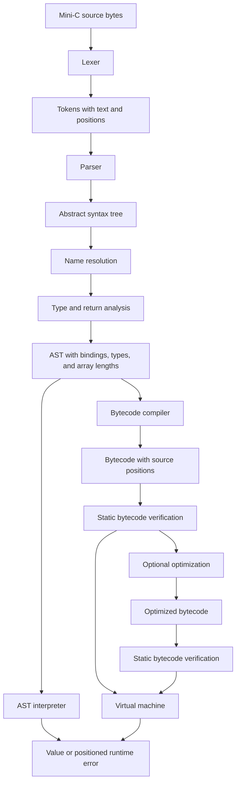

# Compiler architecture

Python implements the compiler. Mini-C is the language of its input programs.
The front end builds a syntax tree and checks its meaning. Execution follows either the interpreter path or the bytecode path.

The abstract syntax tree (AST) represents the program's structure.
Bytecode is a sequence of instructions for execution.
The virtual machine (VM) executes these instructions.



The analysis result contains tables keyed by AST objects. The AST nodes keep their syntax and positions.
Both execution paths use the same arithmetic functions and limits.

## Follow one program

From the repository root, inspect the first example at successive stages.

```sh
python3 -m minic --tokens examples/hello.mc
python3 -m minic --ast examples/hello.mc
python3 -m minic --resolve examples/hello.mc
python3 -m minic --check examples/hello.mc
python3 -m minic --bytecode examples/hello.mc
python3 -m minic --run examples/hello.mc
python3 -m minic --run-vm examples/hello.mc
```

The lexer finds `return` at line 4, column 3, followed by the integer token `0` at column 10.
The parser puts that literal under a return statement inside `main`.
The resolver registers the function. The type checker accepts its integer return value.
The bytecode loads constant zero and returns it. Both execution commands print `0` and exit successfully.

## Module responsibilities

| Module | Input and result |
|---|---|
| [lexer.py](../minic/lexer.py) | Source bytes become a complete token list, including EOF. |
| [parser.py](../minic/parser.py), [ast.py](../minic/ast.py) | Tokens become positioned nodes for expressions, statements, and functions. |
| [resolver.py](../minic/resolver.py) | Each name use selects a declaration through lexical scopes. |
| [type_checker.py](../minic/type_checker.py) | Resolved nodes acquire scalar types and checked array lengths. Function bodies must satisfy return rules. |
| [runtime.py](../minic/runtime.py) | Scalar values, array storage, arithmetic, errors, and execution limits support both engines. |
| [interpreter.py](../minic/interpreter.py) | A checked tree produces a value through explicit stacks of visits and calls. |
| [bytecode_compiler.py](../minic/bytecode_compiler.py), [bytecode.py](../minic/bytecode.py) | A checked tree becomes function records, constants, local slots, and instructions. |
| [control_flow.py](../minic/control_flow.py) | Instructions form basic blocks, successor edges, and entry reachability. |
| [bytecode_verifier.py](../minic/bytecode_verifier.py) | Metadata, instructions, and operand stacks must satisfy the bytecode contract before optimization or VM execution. |
| [bytecode_optimizer.py](../minic/bytecode_optimizer.py) | A copy of the bytecode receives constant folding and control-flow simplification. |
| [vm.py](../minic/vm.py) | Instructions operate on local slots and operand stacks within call frames. |
| [__main__.py](../minic/__main__.py) | The selected command reads the file and writes a result or diagnostic. |

`interpret` and `compile_bytecode` each call `check_types`, which first resolves names.
The optimizer and VM accept the bytecode that the compiler produces. The optimizer keeps the input available for comparison.
Each execution creates fresh state, so one failed execution leaves the program available for another call.

The verifier follows all structural paths from each function entry, including branches with constant conditions.
It stores incoming operand types at block entries and requires the same sequence wherever paths meet.
This adds analysis before execution and exposes invalid compiler output before a particular input can reach it.
Mutable bytecode records require a new analysis for each operation. The optimizer also checks its result before returning it.
The [stack study](stack-analysis.md) describes the guarantees and runtime checks that remain necessary.

## Compare implementation choices

| Decision | C++ | Rust | Python |
|---|---|---|---|
| AST representation | Variants and owned child pointers | Enums, boxes, and vectors | Frozen dataclasses and tuples |
| Node identity for analysis | Node addresses | Explicit `NodeId` values | Object identity with `eq=False` |
| Runtime values | Variant of integer, boolean, and void | `Value` enum | `IntValue`, `BoolValue`, and `VOID` |
| Interpreter traversal | Recursive host calls | Recursive host calls | Resumable generators in an explicit stack |
| VM operands | Shared stack with a base offset per frame | Shared stack with a base offset per frame | Separate operand list per frame |
| Optimizer copy | Copy the program records | Clone the program records | Copy mutable lists and share immutable records |

The AST and runtime definitions provide the corresponding representations in the two predecessors.
The VM source shows each frame's storage and instruction pointer.
[C++ AST](../../compiler-mini-c/src/ast.hpp), [C++ runtime](../../compiler-mini-c/src/runtime.hpp), [C++ VM](../../compiler-mini-c/src/vm.cpp),
[Rust AST](../../compiler-mini-rust/src/ast.rs), [Rust runtime](../../compiler-mini-rust/src/runtime.rs), [Rust VM](../../compiler-mini-rust/src/vm.rs).

Object identity keeps two nodes distinct even when their text and positions match.
Python analysis tables retain those objects, which also retains their storage for the lifetime of the tables.
This avoids a separate node identifier counter.

Python treats `bool` as a subclass of `int`. Separate value classes preserve Mini-C's distinct types and equality rules.
Python integers can also exceed 64 bits. The shared runtime functions enforce the Mini-C range after each arithmetic operation.
Division uses integer magnitudes and reapplies the sign, so `-7 / 2` gives `-3` without a floating-point conversion.

Explicit stacks let execution enforce Mini-C's call limit independently of Python's recursive-call limit.
Each suspended interpreter visit holds a generator. Each VM call allocates an operand list that isolates its pending values.
These objects cost storage per active call and make call ownership visible in the implementation.

## Preserve observable behavior

A source step represents one executed statement or expression. The bytecode compiler emits `STEP` at the corresponding positions.
The optimizer keeps reachable source steps in order even when it removes arithmetic instructions.
Thus, a lower instruction count can still exhaust the same source-step budget at the same position.

In `a[i] = (i = 1)`, both engines save the checked index before evaluating the right operand.
The interpreter stores that offset in the suspended visit. The VM keeps it on the operand stack until `STORE_ELEMENT`.
The shared array storage checks the bounds before Python can index its list.

The comparison script sends one file path to each executable and compares the exit status and both output streams byte for byte.
The paths to both predecessor checkouts follow the sibling layout under `~/Coding`.
The [language contract](language.md) defines the behavior, and the [roadmap](roadmap.md) connects it to the development history.
