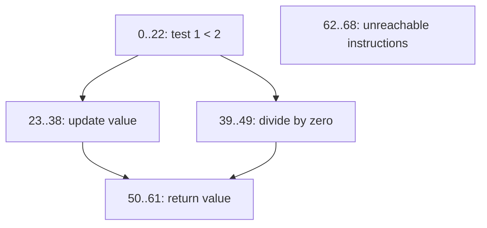

# Read the bytecode control-flow graph

A control-flow graph connects instructions that can execute consecutively.
A basic block is a sequence with one entry.
Execution enters the first instruction and continues until a branch, terminal instruction, or the next block entry.
An edge connects one block to a possible successor.

The [analysis module](../minic/control_flow.py) computes these blocks without executing the program.
It follows both destinations of a conditional jump, even when the condition always selects one destination.
This makes the graph useful for optimization and static analysis.

## Inspect a program

From the repository root, run the inspection tool and the existing bytecode command.

```sh
python3 scripts/inspect_bytecode.py examples/control_flow.mc
python3 -m minic --bytecode examples/control_flow.mc
```

The tool prints one graph per function. Instruction offsets start at zero in each function.
A line such as `block 29..35 reachable -> 48, 36` includes instructions 29 through 35.
The successors are block entry offsets. A conditional jump lists its target first and its fallthrough second.
`none` means that the block has no successor.

The compiler CLI still prints its existing bytecode format.
The separate inspection command adds an explanation without changing reference listings.

## Find block boundaries

Mark the following offsets as block entries:

1. Mark instruction zero.
2. Mark each jump target.
3. Mark the instruction after a jump or terminal instruction, if that instruction exists.

A terminal instruction is `RETURN`, `RETURN_VOID`, or `UNREACHABLE`.
Marking the instruction after a return keeps dead instructions visible as a separate block.
The analysis then follows edges from instruction zero to determine reachability.

The implementation uses a work list instead of recursive Python calls.
This permits long graphs without using Python's call depth for graph traversal.
It requires storage proportional to the number of instructions and edges.

## Trace the loop

In [control_flow.mc](../examples/control_flow.mc), the nested conditions assign zero, one, or two to `result` before the loop.
The following blocks contain the loop and return in `choose`.

| Instructions | Final instruction | Next block |
|---|---|---|
| 28 | `STEP` | Continue at 29 to evaluate the condition. |
| 29 through 35 | `JUMP_IF_FALSE 48` | Enter 36 when `result < 3`. Otherwise, enter 48. |
| 36 through 47 | `JUMP 29` | Return to the condition after incrementing `result`. |
| 48 through 51 | `RETURN` | Return the final value. |
| 52 | `UNREACHABLE` | No edge from entry reaches this block. |

If `result` starts at two, the loop follows `28 -> 29 -> 36 -> 29 -> 48`.
The edge from 36 to 29 allows another iteration.
A graph cycle describes a possible repetition. The graph alone does not determine how many iterations execute.

## Compare structural and executable paths

From the repository root, inspect the [optimization example](../examples/optimization.mc) before and after optimization.

```sh
python3 scripts/inspect_bytecode.py examples/optimization.mc
python3 scripts/inspect_bytecode.py --optimized examples/optimization.mc
```

The original graph contains five blocks.



Block 39 has an incoming edge, although the constant condition prevents its execution.
Block 62 has no path from the function entry. The analyzer marks only block 62 as unreachable in this original graph.
The optimizer computes the condition and removes both the skipped branch and the dead tail.
The optimized graph contains one block, instructions 0 through 35.

From the repository root, inspect the optimized short-circuit example.

```sh
python3 scripts/inspect_bytecode.py --optimized examples/short_circuit.mc
```

The original graph follows both edges of each logical branch.
The optimized graph contains one block, instructions 0 through 18, because the conditions select known paths.
Its remaining `STEP` instructions still charge the source operations that execute.

## Analysis contract

`analyze_control_flow(function)` returns immutable block records and instruction successors.
Each block stores `start`, exclusive `stop`, and `successors`. The printed report uses an inclusive end for reading.
The `reachable` set contains block entry offsets, not every instruction offset.

The analyzer rejects an empty function, unknown opcode, invalid jump target, or reachable fallthrough beyond the instruction sequence.
Jump indices must be Python integers, excluding booleans. It examines jump targets even in dead blocks.
An unreachable tail can fall past the sequence. The report labels that destination `outside(offset)` because execution cannot reach it from entry.
The graph does not establish operand counts, operand types, array bounds, or arithmetic results.

From the repository root, run the graph tests.

```sh
PYTHONPATH=tests python3 -m unittest test_control_flow
```

The tests cover loops, joins, dead code, invalid targets, long graphs, and the inspection command.
The [Rust exercise](../../compiler-mini-rust/docs/control-flow.md) traces the corresponding bytecode manually.
Python records the same graph concepts in an API that later analyses can reuse.
